[](https://laiba-shehbaz.github.io/python-files-errors-assessment/preview.html)

# Personal Finance & Student Attendance Management System

**Assessment 4 – Python Files, Errors, Sets & Comprehensions**

Two small command-line tools built for a training institute:

| Application | File | Purpose |
|---|---|---|
| Institute Expense Tracker | `expense-tracker.py` | Record daily operational expenses (stationery, internet bills, refreshments, transport) and keep them saved in `expenses.csv` |
| Student Attendance Cleaner | `attendance-cleaner.py` | Clean a messy attendance list, remove duplicate students and produce a sorted `attendance-clean.csv` |

---

## Live visual preview

Animated diagrams of both programs (the dots show data moving through the program; the red loop is the `ValueError` retry):




**Open the full interactive preview:** [Live Preview](https://laiba-shehbaz.github.io/python-files-errors-assessment/preview.html) (or [`preview.html`](preview.html) in the repo) – animated diagrams, counters, category bars and a terminal replay of both runs.

| How to view it | Steps |
|---|---|
| On your computer | Download or clone the repository and double-click `preview.html` |
| Online (no setup) | Open `https://htmlpreview.github.io/?https://github.com/laiba-shehbaz/python-files-errors-assessment/blob/main/preview.html` |
| GitHub Pages | Repository **Settings → Pages → Deploy from branch → `main` / root**, then open `https://laiba-shehbaz.github.io/python-files-errors-assessment/preview.html` |

---

## Table of contents
1. [Project structure](#1-project-structure)
2. [Overview of both applications](#2-overview-of-both-applications)
3. [Requirements and how to run](#3-requirements-and-how-to-run)
4. [Task 1 – Expense Tracker in detail](#4-task-1--expense-tracker-in-detail)
5. [Task 2 – Attendance Cleaner in detail](#5-task-2--attendance-cleaner-in-detail)
6. [Errors handled and why](#6-errors-handled-and-why)
7. [How sets and list comprehensions are used](#7-how-sets-and-list-comprehensions-are-used)
8. [Sample run – expense data saved and loaded again](#8-sample-run--expense-data-saved-and-loaded-again)
9. [Testing summary](#9-testing-summary)
10. [Assignment checklist](#10-assignment-checklist)

---

## 1. Project structure

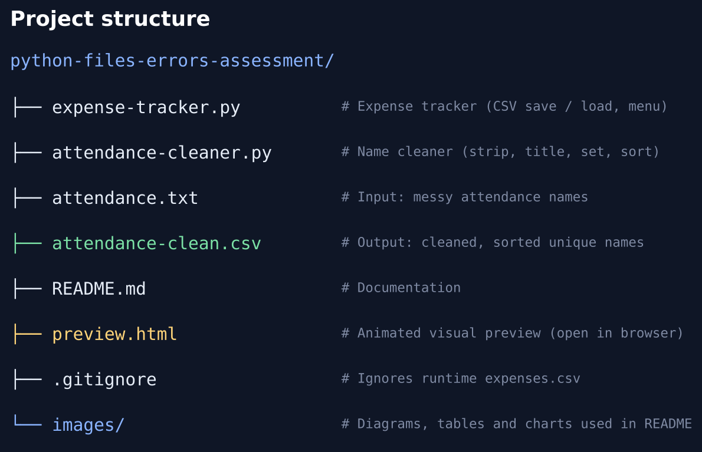

```text
python-files-errors-assessment/
├── expense-tracker.py
├── attendance-cleaner.py
├── attendance.txt
├── README.md
├── preview.html           (animated visual preview)
├── attendance-clean.csv   (generated by attendance-cleaner.py)
└── images/                (diagrams, tables and charts used in this README)
```

`expenses.csv` is created automatically the first time an expense is added, so it is not committed (see `.gitignore`).

---

## 2. Overview of both applications

### Institute Expense Tracker
The institute needs a simple way to record daily operational expenses. The program stores each expense with four fields – `date, item, category, amount` – in `expenses.csv`. Every time it starts it loads the earlier records, so the data is never lost between runs. Administrators can add expenses, view them all, and see how much has been spent per category.

### Student Attendance Cleaner
Attendance is kept in `attendance.txt`, one name per line, but the file is messy: names are repeated, capitalised inconsistently (`BILAL AHMAD`, `ayesha khan`) and padded with spaces. The program cleans every name, finds the unique students, sorts them A–Z and saves the result to `attendance-clean.csv`.

---

## 3. Requirements and how to run

- Python 3.8+ (standard library only: `csv`, `math`, `datetime`)

```bash
# Task 1 – Expense Tracker
python expense-tracker.py

# Task 2 – Attendance Cleaner (attendance.txt must be in the same folder)
python attendance-cleaner.py
```
On some systems use `python3` instead of `python`.

---

## 4. Task 1 – Expense Tracker in detail

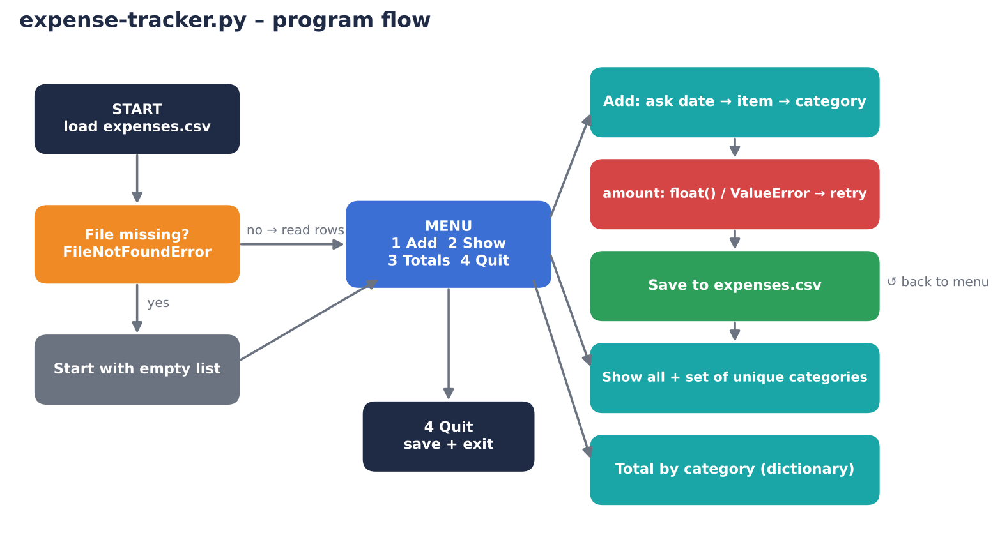

**Features**
- Saves to `expenses.csv` with the header `date,item,category,amount`.
- **On start** the file is loaded. If it does not exist, `FileNotFoundError` is caught and the program starts with an empty list.
- **Menu**

| Option | Action |
|---|---|
| `1. Add New Expense` | Enter date (Enter = today), item name, category and amount |
| `2. Show All Expenses` | Table of every expense, the overall total and the set of unique categories |
| `3. Calculate Total Expenses by Category` | Total spent per category plus the grand total |
| `4. Exit` | Save and quit |

- If the amount is not a valid number, `ValueError` is caught and the user is asked again.
- A **set** is used to display the unique categories.
- Each new expense is **saved immediately**, so it is available the next time the program runs.

**Saved data (`expenses.csv`)**
```csv
date,item,category,amount
2026-11-02,A4 paper and markers,Stationery,1250.50
2026-11-03,Internet bill,Utilities,4500.00
2026-11-04,Tea and snacks,Refreshments,850.00
2026-11-05,Van fuel,Transport,3200.00
2026-11-06,Whiteboard markers,Stationery,600.00
```

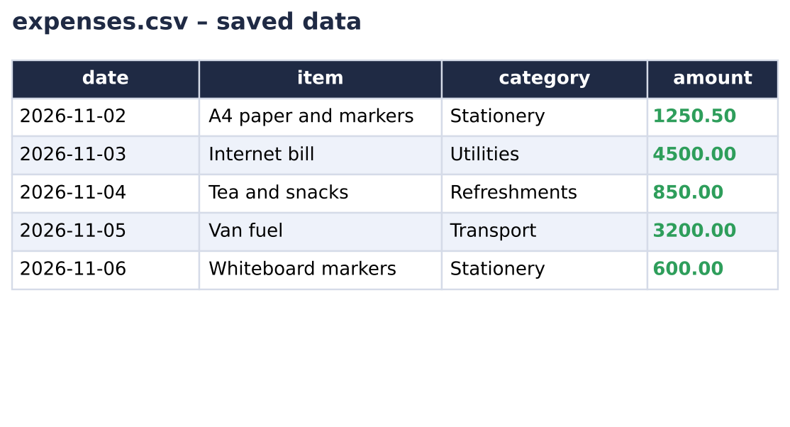

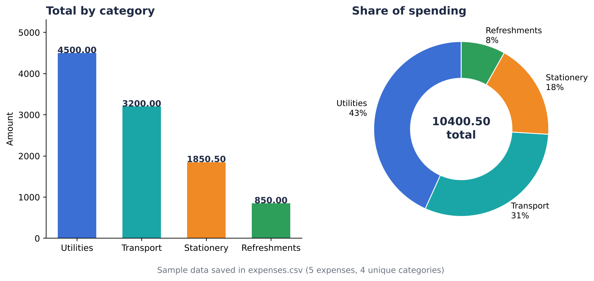

---

## 5. Task 2 – Attendance Cleaner in detail

**Steps performed**
1. Read every line of `attendance.txt`.
2. Clean the names using `strip()` and `title()` inside a **list comprehension** (blank lines are skipped, extra spaces inside a name are collapsed).
3. Put the cleaned names in a **set** to find the unique students and count them.
4. Sort the unique names alphabetically.
5. Save them to `attendance-clean.csv` and print the original record count, unique count and the cleaned list.

**Program output**
```text
Original number of records : 23
Blank lines skipped        : 2
Records after cleaning     : 21
Unique students (set)      : 11
Duplicates removed         : 10

Cleaned attendance list (sorted A-Z):
   1. Ahmed Hassan
   2. Ali Raza
   3. Ayesha Khan
   4. Bilal Ahmad
   5. Fatima Noor
   6. Hamza Ali
   7. Hassan Raza
   8. Maryam Iqbal
   9. Sara Malik
  10. Usman Tariq
  11. Zainab Fatima

Saved 11 names to attendance-clean.csv
```
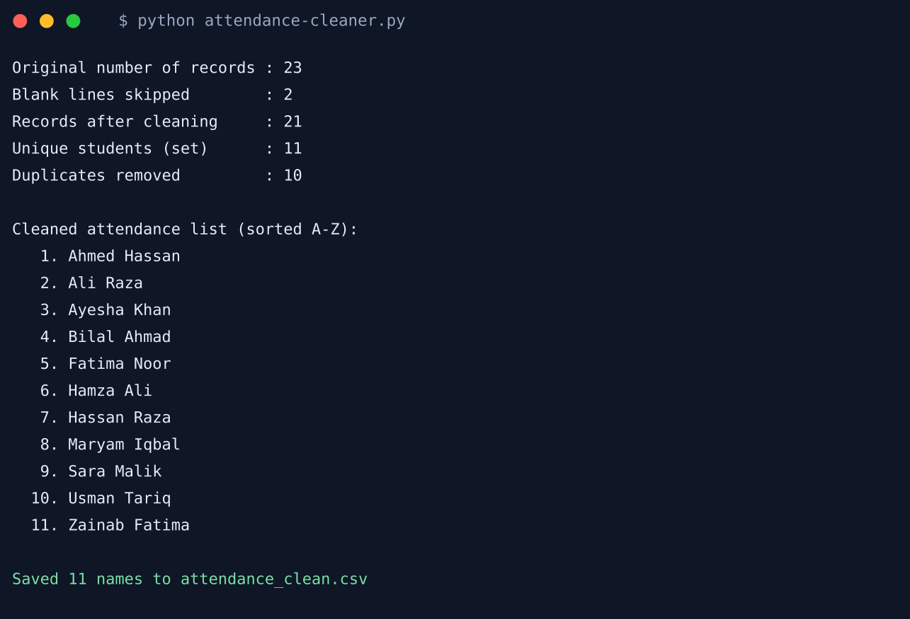

**Before and after cleaning**

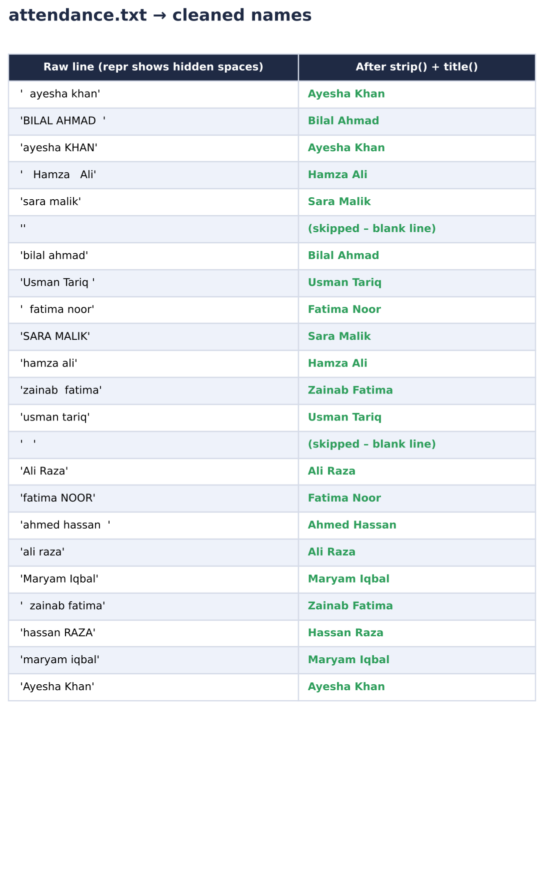

**Result – `attendance-clean.csv`**
```csv
name
Ahmed Hassan
Ali Raza
Ayesha Khan
Bilal Ahmad
Fatima Noor
Hamza Ali
Hassan Raza
Maryam Iqbal
Sara Malik
Usman Tariq
Zainab Fatima
```
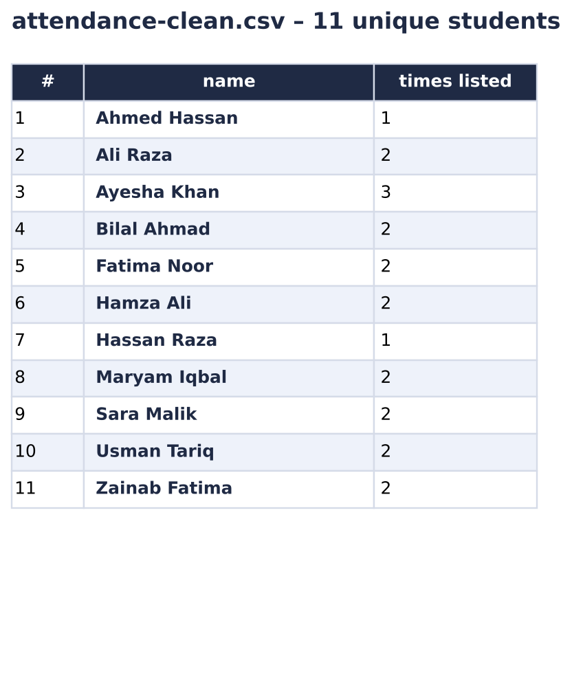

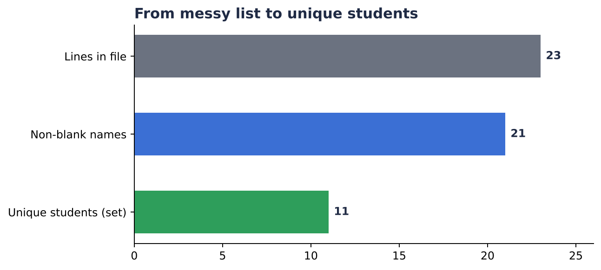

---

## 6. Errors handled and why

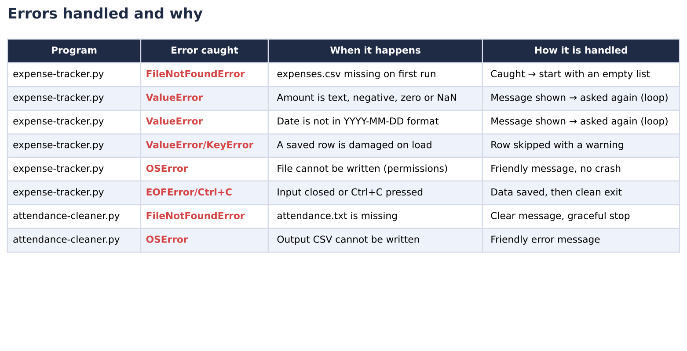

| Error | Where | Why it is handled |
|---|---|---|
| `FileNotFoundError` | Loading `expenses.csv` | On the first run the file does not exist yet. That is normal, so the program starts with an empty list instead of crashing. |
| `ValueError` (amount) | Add New Expense | Users may type text such as `abc`. `float()` raises `ValueError`; the program explains the problem and asks again. Zero, negative and `nan` values are also rejected because they are not valid expenses. |
| `ValueError` (date) | Add New Expense | Dates must be `YYYY-MM-DD` so the CSV stays consistent and sortable. |
| `ValueError` / `KeyError` | Loading rows | If a row is damaged (for example edited by hand) it is skipped with a warning instead of stopping the program. |
| `OSError` | Saving files | Problems such as permissions or a full disk show a friendly message. |
| `EOFError` / `KeyboardInterrupt` | Menu loop | If input is closed or Ctrl+C is pressed, the data is still saved before exiting. |
| `FileNotFoundError` | Reading `attendance.txt` | The user gets a clear instruction to place the file next to the script. |

Example:
```text
Error: attendance.txt was not found. Place it next to this script.
```

---

## 7. How sets and list comprehensions are used

### Sets
A **set** stores only unique values and ignores duplicates automatically.

| Program | Code | Purpose |
|---|---|---|
| Expense Tracker | `{expense["category"] for expense in expenses}` | Display every unique category once, even if `Stationery` appears many times |
| Attendance Cleaner | `unique_students = set(cleaned)` | Remove duplicate students and count them with `len(unique_students)` |

Sets have no fixed order, so the unique names are passed through `sorted()` before they are saved.

### List comprehension
A **list comprehension** builds a new list in a single readable line. The attendance cleaner uses it to clean all names:

```python
cleaned = [" ".join(line.strip().title().split()) for line in raw_lines if line.strip()]
```

| Part | Meaning |
|---|---|
| `for line in raw_lines` | Go through every line of the file |
| `if line.strip()` | Skip blank lines |
| `line.strip()` | Remove spaces at the start and end |
| `.title()` | Capitalise each word (`BILAL AHMAD` → `Bilal Ahmad`) |
| `" ".join(....split())` | Collapse extra spaces inside a name (`Hamza   Ali` → `Hamza Ali`) |

---

## 8. Sample run – expense data saved and loaded again

> The menu is printed in full once; repeated menu lists are shortened here for readability.

### Run 1 – no `expenses.csv` yet (invalid inputs tested, data saved)
```text
expenses.csv not found. Starting with an empty expense list.

===== Institute Expense Tracker =====
1. Add New Expense
2. Show All Expenses
3. Calculate Total Expenses by Category
4. Exit
Choose an option (1-4): 1

--- Add New Expense ---
Date (YYYY-MM-DD, Enter for today): 2026-11-02
Item: A4 paper and markers
Category: stationery
Amount: abc
  Invalid amount. Please enter a positive number, e.g. 12.50
Amount: 1250.50
Saved: A4 paper and markers (Stationery) - 1250.50

Choose an option (1-4): 1

--- Add New Expense ---
Existing categories: Stationery
Date (YYYY-MM-DD, Enter for today): 2026-13-45
  Invalid date. Use the format YYYY-MM-DD, e.g. 2026-11-02
Date (YYYY-MM-DD, Enter for today): 2026-11-03
Item: Internet bill
Category: utilities
Amount: -5
  Invalid amount. Please enter a positive number, e.g. 12.50
Amount: 4500
Saved: Internet bill (Utilities) - 4500.00

Choose an option (1-4): 1

--- Add New Expense ---
Existing categories: Stationery, Utilities
Date (YYYY-MM-DD, Enter for today): 2026-11-04
Item: Tea and snacks
Category: refreshments
Amount: 850
Saved: Tea and snacks (Refreshments) - 850.00

Choose an option (1-4): 1

--- Add New Expense ---
Existing categories: Refreshments, Stationery, Utilities
Date (YYYY-MM-DD, Enter for today): 2026-11-05
Item: Van fuel
Category: transport
Amount: 3200
Saved: Van fuel (Transport) - 3200.00

Choose an option (1-4): 9
  Invalid choice. Please enter 1, 2, 3 or 4.

Choose an option (1-4): 2

--- All Expenses ---
Date        Item                      Category           Amount
---------------------------------------------------------------
2026-11-02  A4 paper and markers      Stationery        1250.50
2026-11-03  Internet bill             Utilities         4500.00
2026-11-04  Tea and snacks            Refreshments       850.00
2026-11-05  Van fuel                  Transport         3200.00
---------------------------------------------------------------
Total                                                   9800.50

Unique categories (4): Refreshments, Stationery, Transport, Utilities

Choose an option (1-4): 3

--- Total Expenses by Category ---
Refreshments       850.00
Stationery        1250.50
Transport         3200.00
Utilities         4500.00
-------------------------
Grand total       9800.50

Choose an option (1-4): 4
Goodbye! 4 expense(s) saved to expenses.csv.
```
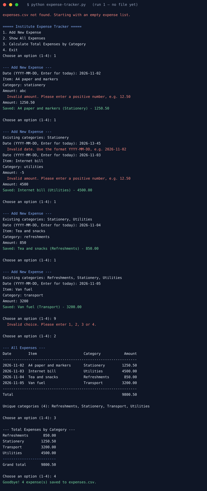

### Run 2 – program started again, previous data loaded
```text
Loaded 4 expense(s) from expenses.csv.

===== Institute Expense Tracker =====
1. Add New Expense
2. Show All Expenses
3. Calculate Total Expenses by Category
4. Exit
Choose an option (1-4): 2

--- All Expenses ---
Date        Item                      Category           Amount
---------------------------------------------------------------
2026-11-02  A4 paper and markers      Stationery        1250.50
2026-11-03  Internet bill             Utilities         4500.00
2026-11-04  Tea and snacks            Refreshments       850.00
2026-11-05  Van fuel                  Transport         3200.00
---------------------------------------------------------------
Total                                                   9800.50

Unique categories (4): Refreshments, Stationery, Transport, Utilities

Choose an option (1-4): 1

--- Add New Expense ---
Existing categories: Refreshments, Stationery, Transport, Utilities
Date (YYYY-MM-DD, Enter for today): 2026-11-06
Item: Whiteboard markers
Category: stationery
Amount: 600
Saved: Whiteboard markers (Stationery) - 600.00

Choose an option (1-4): 3

--- Total Expenses by Category ---
Refreshments       850.00
Stationery        1850.50
Transport         3200.00
Utilities         4500.00
-------------------------
Grand total      10400.50

Choose an option (1-4): 4
Goodbye! 5 expense(s) saved to expenses.csv.
```
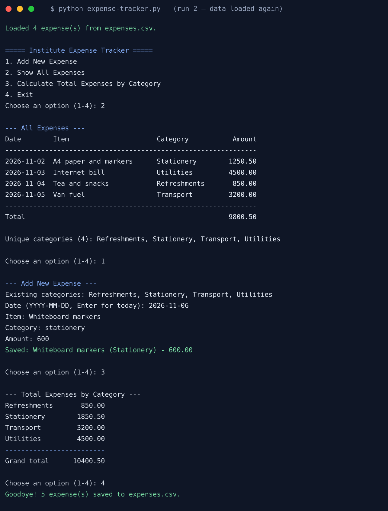

Run 2 begins with `Loaded 4 expense(s) from expenses.csv.` and shows the four records saved in run 1. It then saves a fifth expense, proving that the data is **saved** and **loaded again** successfully.

---

## 9. Testing summary

| Test | Input | Result |
|---|---|---|
| First run without a file | no `expenses.csv` | `FileNotFoundError` caught, program starts empty |
| Invalid amount (text) | `abc` | Error message, amount requested again |
| Invalid amount (negative) | `-5` | Rejected, amount requested again |
| Invalid date | `2026-13-45` | Rejected, date requested again |
| Invalid menu choice | `9` | Message shown, menu repeated |
| Data persistence | restart program | 4 saved records loaded, 5th added and saved |
| Duplicate attendance names | `ayesha khan`, `ayesha KHAN`, `Ayesha Khan` | Merged into one `Ayesha Khan` |
| Extra spaces / blank lines | `"   Hamza   Ali"`, empty lines | Cleaned to `Hamza Ali`, blank lines skipped |
| Missing `attendance.txt` | file removed | Clear error message, no crash |

---

## 10. Assignment checklist

- [x] `expenses.csv` with columns `date,item,category,amount`
- [x] Load on start; `FileNotFoundError` caught, empty start
- [x] Menu: Add New Expense, Show All Expenses, Calculate Total Expenses by Category, Exit
- [x] Date, item, category and amount are entered by the user
- [x] `ValueError` caught for invalid amount and user asked again
- [x] Set used to display unique categories
- [x] New expenses saved to the CSV and available on the next run
- [x] `attendance.txt` read; names cleaned with `strip()` and `title()` in a list comprehension
- [x] Set used to find unique students and count them
- [x] Names sorted alphabetically and saved to `attendance-clean.csv`
- [x] Original record count, unique count and cleaned list displayed
- [x] README with overview, run instructions, errors, sets/comprehensions and a sample run

---

*Author: your name | Assessment 4: Personal Finance & Student Attendance Management System | Python Files, Errors, Sets & Comprehensions*
